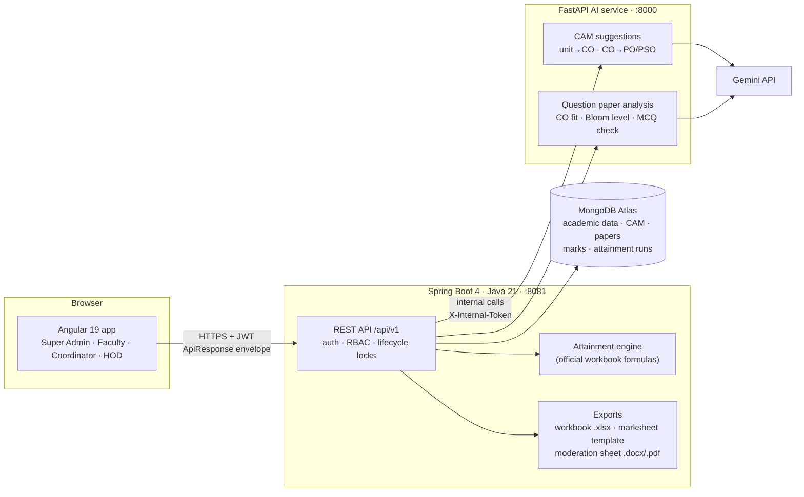
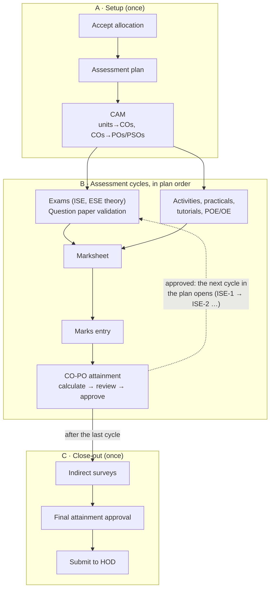
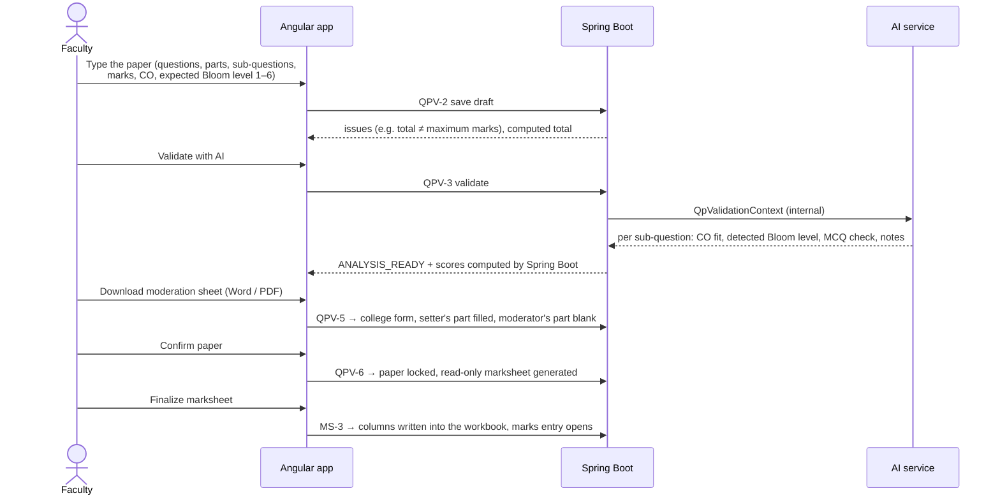

# Automated CO-PO Attainment Engine

A web platform that takes an engineering course from its first plan to its final NBA-style **CO-PO attainment report**. Faculty map course outcomes (COs) to program outcomes (POs and PSOs), validate their question papers with AI, enter marks, and approve attainment calculations that follow the institution's official workbook formulas. Every step is recorded, so the course file builds itself over the semester.

Built for the Department of Electronics and Computer Engineering, Walchand Institute of Technology, Solapur.

> **Status, 28 Oct 2026.** The frontend runs end to end on mock data. The Spring Boot backend covers academic structure only, and the AI service covers CAM suggestions and question paper validation. The two services aren't wired to the frontend yet. The agreement between all three is `frontend/API_CONTRACT.md`, version 2.8. See [Progress](#progress).

---

## Contents

1. [What it does](#what-it-does)
2. [Team](#team)
3. [Architecture](#architecture)
4. [Repository layout](#repository-layout)
5. [The faculty course lifecycle](#the-faculty-course-lifecycle)
6. [Key flows](#key-flows)
7. [Roles](#roles)
8. [API contract](#api-contract)
9. [Progress](#progress)
10. [Getting started](#getting-started)
11. [Tests](#tests)
12. [Known gaps and next steps](#known-gaps-and-next-steps)
13. [Working rules](#working-rules)
14. [Documents](#documents)

---

## What it does

Outcome-based education asks every course to show how well students reached its course outcomes, and how those outcomes feed the program outcomes. The institution does this today in hand-kept Excel workbooks. This project replaces them with one strictly ordered workflow per course:

- **Prepare.** At the start of each semester the department **coordinator** enters the faculty list, the **syllabus load distribution** in the college's format (every subject's hours, credits and assessment structure), the POs and PSOs, and allocates every subject to a faculty member, who is emailed.
- **Plan.** The faculty accepts each allocated subject, gets an assessment plan generated from the coordinator's structure, and builds the **course articulation matrix (CAM)**. An AI suggests unit → CO links and CO → PO/PSO levels; the faculty decides every value.
- **Assess.** For each exam the faculty **types the question paper** with the CO and expected Bloom level of every question. The AI checks the paper, the faculty downloads the college's moderation sheet, and the confirmed paper generates the **marksheet**. The faculty then enters the marks.
- **Attain.** After each assessment the backend calculates **cumulative CO-PO attainment** with the institution's formula. The faculty sees every step of the calculation and approves it.
- **Close.** Indirect surveys, final attainment approval and submission to the head of department.

A **live course workbook**, laid out like the institution's reference Excel templates, fills itself as each step completes. Faculty view it and download it; nobody edits it by hand.

Three rules shape the whole design:

| Rule | Why |
| --- | --- |
| **The backend owns every calculation.** Attainment levels, CO and PO/PSO attainment, and validation scores are computed only in Spring Boot. The frontend displays them and never recomputes them. | One source of truth that matches the official workbooks |
| **AI only suggests.** CAM links and levels, paper reviews and Bloom levels are advice. Nothing AI-generated is saved without a faculty decision. | Accountability for accreditation |
| **The server enforces the lifecycle.** A step unlocks only when the previous one is done; a locked call returns `409 STAGE_LOCKED`. The UI shows the locks but never decides them. | Data can't be entered out of order |

---

## Team

| Person | Owns | Stack | Folder |
| --- | --- | --- | --- |
| **Rohan Belsare** | UI/UX, the Angular app, the API contract, the TypeScript models | Angular 19, Tailwind CSS | [`frontend/`](frontend/) |
| **Abhijeet** | Academic data, auth and access control, semester setup and allocation emails, assessments, marks, the attainment engine, workbook and file exports | Spring Boot 4, Java 21, Spring Data MongoDB | [`Abhijeet/`](Abhijeet/) |
| **Mayuri** | AI pipelines: CAM suggestions and question paper analysis | Python 3.12, FastAPI, Pydantic, Google Gemini | [`Mayuri/academic-ai-service/`](Mayuri/academic-ai-service/) |

The contract marks each area with its owner: **[A]** for Abhijeet, **[M]** for Mayuri.

---

## Architecture



| Part | Responsibility | Talks to |
| --- | --- | --- |
| **Angular app** | Every screen; shows locks, statuses and calculated numbers exactly as the API returns them. In mock mode it runs on in-memory stores that follow the contract's rules. | Spring Boot only |
| **Spring Boot** | The system of record: academic structure, semester setup and allocation (with the faculty emails), offerings, lifecycle and locks, CAM, question papers, marksheets, marks, attainment runs, the live workbook, every file export | MongoDB, the AI service |
| **AI service** | Stateless suggestion and analysis pipelines. It never stores data and never writes into a CAM or paper. | Gemini, called only by Spring Boot |
| **MongoDB** | Documents per institution, program, course offering, CAM, paper, marksheet, marks and attainment run | — |

**Conventions that cross every boundary**, from contract §2:
- every response uses the `ApiResponse<T>` envelope; errors carry a user-safe `message` and an `errorCode`;
- editable documents carry a `version`, and a stale write returns `409 VERSION_CONFLICT`;
- long-running work (AI analysis, exports) returns `202` and the UI polls;
- AI output carries `AiProvenance` (model, prompt template, time), so the UI can label it.

---

## Repository layout

```
Automated CO-PO attainment engine/
├── README.md                     ← this file
├── AGENTS.md                     ← requirement status and the rules every contributor and AI agent follows
├── frontend/                     ← Angular 19 app (Rohan)
│   ├── API_CONTRACT.md           ← the API contract between all three parts (v2.8)
│   └── src/app/
│       ├── core/
│       │   ├── models/           ← TypeScript types that mirror the contract
│       │   ├── services/         ← API services (mock or HTTP, switched by environment.useMockData)
│       │   ├── mocks/            ← in-memory stores that follow the contract's rules, plus demo data
│       │   ├── auth/ guards/     ← session, role guards
│       ├── features/
│       │   ├── auth/             ← unified login
│       │   ├── admin/            ← Super Admin: institution, academic years and programs
│       │   ├── faculty/          ← faculty dashboard and the course workspace
│       │   │   └── course/       ← lifecycle stepper, CAM, question paper, marksheet, workbook, attainment
│       │   └── analytics/        ← HOD dashboard (pending specification)
│       └── shared/               ← app shell, UI components, icons, pipes
├── Abhijeet/                     ← Spring Boot backend (Abhijeet)
│   └── src/main/java/com/copo/attainment_engine/academic/
│       ├── controller/ service/ repository/ model/ dto/
├── Mayuri/academic-ai-service/   ← FastAPI AI service (Mayuri)
│   ├── app/{api,core,pipelines,prompts,schemas,services/llm}
│   └── tests/
└── reviews/                      ← review reports and suggested tests for teammates (untracked)
```

---

## The faculty course lifecycle

Every course offering moves through three phases. Each step unlocks only when the previous one is done (contract §7.1).



| Step | What happens | Screen |
| --- | --- | --- |
| **Accept allocation** | Check the subject the coordinator allocated and how it's assessed, then accept it | **Built** |
| **Assessment plan** | Generated from the coordinator's load distribution; the faculty sets the order, dates and activity types, then finalizes | **Built** |
| **CAM** | Four steps: course inputs → unit → CO mapping (AI stage 1) → CO → PO/PSO matrix (AI stage 2) → finalize | **Built** |
| **Question paper validation** | Type the paper → automatic checks → AI review → moderation sheet → confirm | **Built** |
| **Marksheet** | Generated from the confirmed paper, read-only; finalizing writes its columns into the workbook | **Built** (exam papers) |
| Marks entry | Import the filled Excel template or type marks; the server flags invalid values; submit | Placeholder |
| **CO-PO attainment** | Read-only inputs and targets → calculate → every step shown → approve | **Built** |
| Indirect surveys | Course exit, examiner and additional survey scores per CO | Placeholder |
| **Final attainment** | The same calculation page in final mode | **Built** |
| Submit to HOD | Hand the approved final attainment to the department head | Placeholder |
| **Course workbook** | Main, PO & PSO attainment and Data sheets, filled automatically | **Built** |

Assessment cycles exist only for the components a subject actually has: a subject without ISE has no ISE steps and no ISE columns in its workbook.

Before any ESE marks exist, ESE, direct, overall and PO/PSO values are shown as **pending**; the engine never assumes an ESE score of 0.

---

## Key flows

### Coordinator semester setup

The department coordinator (a faculty member with the coordinator role, given by Super Admin) prepares each semester, III to VIII, in order (contract §15):

1. **Semester.** Create the setup for the academic year, with its divisions.
2. **Faculty.** Add the department's faculty (name, college email, phone) by hand or by importing an Excel sheet; the import shows a preview with every row's errors and imports only after confirmation.
3. **Syllabus load distribution.** The college's table: per course the group, code, name, L/T/P, credits, ESE, OE/POE, ISE and ICA, with how each column's marks are earned (e.g. ISE 40 = 2 tests × 15 + 2 activities × 5). Elective and MDM slots list their options. This table is the single source of every subject's assessment structure.
4. **POs and PSOs.** The 11 POs, shared by all departments, and the department's 3 PSOs.
5. **Declaration.** The coordinator confirms the table is correct; it locks, and who confirmed and when is recorded.
6. **Allocation.** Each subject (and division) gets one faculty member; a faculty member can take several subjects across semesters. Views by subject and by faculty.
7. **Complete.** Refused while anything is unassigned. Each faculty member gets one email listing their subjects, with a set-password link; they then accept each subject, and the coordinator tracks who has accepted.

### Course articulation matrix (CAM), two AI stages

1. **Inputs.** The faculty types or pastes the course objectives, COs and units, and titles the planned activities, practicals and tutorials. The POs and PSOs come read-only from the coordinator. COs carry no Bloom level, and the CAM holds no expected percentages.
2. **Stage 1, unit → CO.** The AI suggests which units teach which CO, with a rationale. The faculty edits the links and confirms the mapping; every CO needs at least one unit.
3. **Stage 2, CO → PO/PSO.** Only after stage 1 is confirmed. The AI suggests a level (3 / 2 / 1 / blank) per cell, with a rationale and the units and items it relies on, judged against a proposed scoring rubric. Doubtful cells are flagged "needs review" and can't be accepted in bulk.
4. **Finalize.** The whole CAM locks and feeds attainment.

### Question paper → marksheet → workbook



- The paper form follows the college's layout. A question has sub-questions directly, or parts (a), (b) with their own CO. An optional "attempt any N of M" rule counts the N highest marks.
- The moderation sheet is the college's *ISE Question Paper Moderation Sheet*. Moderation itself is done by hand: there is no moderator role.
- The paper can be **reopened** until its marksheet is finalized.

### CO-PO attainment

The formula is transcribed from the institution workbooks *CO Attainment_60 ESE(TH)V0.2.xlsx* and *CO Attainment_60 ESE(PR)V0.1.xlsx* (contract §14.1) and runs only in the backend. Every weight and threshold is set by the coordinator; the defaults are:

| Setting | Default |
| --- | --- |
| ISE / ESE weight | 0.4 / 0.6 |
| Direct / indirect weight | 0.8 / 0.2 |
| ISE target | 60 % of marks; levels at 50 / 60 / 70 % of students |
| ESE target | 50 % of marks; levels at 60 / 70 / 80 % (theory) or 50 / 60 / 70 % (practical) |

Runs are **cumulative**: each one uses only assessments whose marks are submitted. The faculty previews a run, sees each step of the calculation, and approves it; approval updates the workbook and opens the next cycle.

---

## Roles

| Role | Portal | Status |
| --- | --- | --- |
| Super Admin | `/admin`: institution, academic years, departments, programs, users and roles | Screens built (institution, academic years and programs); the syllabus, course and PO/PSO screens were removed in v2.8, the coordinator owns that data |
| Faculty | `/faculty`: dashboard and course workspace | Screens built for the main steps |
| Coordinator | Inside the faculty portal, one department: semester setup, faculty list, syllabus load distribution, POs/PSOs, allocation, targets and thresholds | Contract confirmed (v2.8); screens being built |
| HOD | `/analytics` | Workflow pending specification; do not implement |
| Student, Guest | — | Pending specification; do not implement |

Removed from scope: the lab assistant role (faculty enter their own marks), the moderator role (moderation is manual on the college sheet), uploading and parsing paper files (faculty type the paper), a separate AI report-analysis screen (the live workbook replaces it), and AI question generation and the reference library (removed 28 Oct 2026).

---

## API contract

[`frontend/API_CONTRACT.md`](frontend/API_CONTRACT.md) is the source of truth for every request and response. It is written so all three parts can be built in parallel; the mock stores in `frontend/src/app/core/mocks/` implement the same rules, so their tests show the expected behaviour.

| § | Area | Owner | Status |
| --- | --- | --- | --- |
| 2–4 | Conventions, shared types, roles and access | All | Confirmed |
| 5 | Auth and session | A | Confirmed |
| 6 | Academic structure (read), POs and PSOs | A | Confirmed (Module 1 shapes) |
| 7 | Faculty workspace and lifecycle | A | Confirmed |
| 8 | Assessment plan, generated from the load distribution | A | Confirmed (v2.8) |
| 9 | Course articulation matrix | A + M | Confirmed; scoring rubric proposed (O-21) |
| 10 | Question paper validation, moderation sheet | A + M | Confirmed (v2.7) |
| 11 | Knowledge base and AI question generation | — | Removed in v2.8 |
| 12 | Marksheet structure | A | Confirmed; template cell formatting pending |
| 13 | Marks entry | A | Confirmed |
| 14 | CO-PO attainment and the live workbook | A | Confirmed, including the formulas |
| 15 | Coordination: semester setup, faculty, load distribution, POs/PSOs, allocation, targets | A | Confirmed (v2.8); open O-25 to O-28 |
| 16 | Super Admin | A | Confirmed; narrowed in v2.8 |
| 17 | HOD | — | Pending |
| 18–20 | Error codes, open questions, change log | — | — |

Open questions that still need a team decision are listed in contract §19 (for example O-22, several paper sets per assessment, and O-24, an MCQ answer key).

---

## Progress

### Frontend — Angular 19 (Rohan)

| Area | Status | Notes |
| --- | --- | --- |
| Unified login, role-based routing, app shell, design system | Done | Editorial design: white, light serif headings, bronze accent |
| Super Admin: institution setup, academic years and programs | Done (mock data) | The course catalogue, curriculum, electives, offerings, PO/PSO, course outcome and CO-PO mapping screens were removed: the coordinator and the CAM own that data |
| Faculty dashboard and course workspace with the lifecycle stepper | Done (mock data) | Locks and next actions come from the API |
| CAM: inputs, two AI stages, matrix, finalize | Done (mock data) | Contract v2.4 |
| Question paper validation: typed paper, checks, AI review, moderation sheet, confirm, reopen | Done (mock data) | Contract v2.7 |
| Marksheet for exam papers, finalize into the workbook | Done (mock data) | Activity/practical marksheet editor not built |
| Live course workbook: Main, PO & PSO, Data | Done (mock data) | |
| Attainment calculation, review and approval; final attainment | Done (mock data) | Numbers come from fixtures generated with the official formula |
| Accept allocation and the generated assessment plan; CAM with the coordinator's POs/PSOs read-only and items fixed by the plan | Done (mock data) | Contract v2.8 §7, §8, §9 |
| Marks entry, indirect surveys, submission | Placeholder pages | Show the real lock state; screens to design next |
| Coordinator: dashboard, semester creation, setup stepper, divisions | Done (mock data) | Contract v2.8 §15.1 |
| Coordinator: faculty list, add/edit/deactivate, Excel import with preview | Done (mock data) | §15.3; the demo reads and writes .xlsx itself, Spring Boot does it for real |
| Coordinator: syllabus load distribution (the college's table, row editor, marks breakdown, electives, MOOC), declaration and revision | Done (mock data) | §15.4; Semester VII is seeded from the college's table (800 marks) |
| Coordinator: POs/PSOs, subject allocation (by subject and by faculty, with weekly hours), completion, emails, acceptance tracking and reminders | Done (mock data) | §15.5 to §15.7; the faculty side of acceptance (FAC-4) is next |
| HOD, student, guest | Not to be built until specified | |
| Connecting to the real backend | Not started | Mock mode is on (`environment.useMockData = true`) |

### Backend — Spring Boot (Abhijeet)

| Area | Status | Notes |
| --- | --- | --- |
| Project setup, MongoDB connection | Done | Spring Boot 4.1, Java 21, port 8081 |
| Academic structure CRUD: institutions, departments, programs, program years, syllabi | Done | `/api/institutions`, `/api/departments`, `/api/programs`, `/api/program-years`, `/api/syllabi` |
| A newer version with 127 tests | In review | Reviewed outside this repo; 100 tests pass and 27 bugs are listed in `reviews/Attainment-Engine-Backend-review.pdf` |
| Faculty, course assignments, offerings, dashboard, course outcomes | In review | Branch `abhijeet-backend-integration`; required changes in `reviews/Abhijeet-backend-integration-review-2026-10-28.pdf` |
| Coordinator semester setup, faculty import, load distribution, POs/PSOs, allocation emails | Not started | Contract §15 (v2.8) |
| Auth and RBAC, lifecycle locks | Not started | Contract §5, §7 |
| Assessment plan, CAM storage and AI calls | Not started | §8, §9 |
| Question papers, moderation sheet, marksheet, marks entry | Not started | §10 (full backend spec in §10.7), §12, §13 |
| Attainment engine, live workbook, exports | Not started | §14 |

### AI service — FastAPI (Mayuri)

| Area | Status | Notes |
| --- | --- | --- |
| CAM stage 1: unit → CO suggestions | Done | `POST /cam/unit-mapping/suggestions` |
| CAM stage 2: CO → PO/PSO suggestions with evidence | Done | `POST /cam/co-po-correlation/suggestions` |
| Internal token check, error envelope, Gemini provider with timeout and output retry | Done | Reviewed, fixed and merged on 27 Oct 2026 |
| Question paper analysis | Done | `POST /question-paper/validate` (contract §10.7.8), merged 28 Oct 2026; small follow-ups in `reviews/Mayuri-qp-validation-review-2026-10-28.pdf` |

---

## Getting started

### Frontend (works on its own, with mock data)

Needs Node.js 20 or newer.

```bash
cd frontend
npm install
npm start
```

Open http://localhost:4200 and sign in with a demo account (mock mode only):

| Role | Email | Password |
| --- | --- | --- |
| Faculty | `faculty@wit.edu` | `password123` |
| Coordinator (ECE; also a faculty member) | `coordinator@wit.edu` | `password123` |
| Super Admin | `superadmin@wit.edu` | `password123` |
| HOD | `hod.ecm@wit.edu` | `password123` |

Demo courses in the faculty dashboard:

| Course | Shows |
| --- | --- |
| 23ECU7E1T Network Security (Final Year, sem VII) | Question paper validation for ISE-3 → moderation sheet → marksheet → workbook |
| EC306 Network Security | A CAM still in draft: both AI stages |
| CS301 Operating Systems | ISE-2 marks submitted, attainment ready to calculate and approve |
| CS304 Computer Networks | Close-out: final attainment ready |
| CS302 Database Management Systems | ISE-1 marks entry in progress |

The coordinator account opens on **Semester setup**: Semester VII of 2026-27 already has its load distribution typed in from the college's table and is ready to declare (the department's PSOs are already filled). Declare it, allocate the 13 subjects and complete: the emails appear in the last step. Semester V is already completed, and the faculty account (`faculty@wit.edu`) has two of its subjects waiting: accept one, order its assessment plan and finalize it, and its CAM and cycles open. Signing out and in again keeps the demo data; reloading the page resets it.

The mock data lives in memory and resets when the page reloads.

### Backend

Needs Java 21 and a MongoDB database (Atlas or local).

```bash
cd Abhijeet
export SPRING_MONGODB_URI="<your connection string>"   # PowerShell: $env:SPRING_MONGODB_URI="..."
./mvnw spring-boot:run                                  # Windows: mvnw.cmd spring-boot:run
```

The API starts on http://localhost:8081. Keep the connection string out of `application.properties` and out of git.

### AI service

Needs Python 3.12 or newer and a Gemini API key. Full instructions: [`Mayuri/academic-ai-service/README.md`](Mayuri/academic-ai-service/README.md).

```bash
cd Mayuri/academic-ai-service
python -m venv .venv
.venv\Scripts\activate             # macOS/Linux: source .venv/bin/activate
pip install -r requirements-dev.txt
copy .env.example .env             # then set GEMINI_API_KEY; never commit .env
uvicorn app.main:app --port 8000 --reload
```

Interactive API docs: http://localhost:8000/docs.

---

## Tests

| Part | Command | Last result |
| --- | --- | --- |
| Frontend | `cd frontend && npx ng test --watch=false --browsers=ChromeHeadless` | 130 passing |
| Frontend build | `cd frontend && npx ng build` | Passing |
| AI service | `cd Mayuri/academic-ai-service && pytest` | 82 passing, plus 2 live Gemini tests run separately |
| Backend | `cd Abhijeet && ./mvnw test` | Context-load test in this repo; the reviewed version has 127 tests |

The frontend tests cover the mock stores' rules (the coordinator's semester setup and its step order, the faculty list and Excel import, the load distribution rules, declaration and revision, allocation, completion and the emails, accepting an allocation and the generated plan, CAM stages, paper checks and states, the moderation sheet, the marksheet and workbook updates, lifecycle locks) and the draft logic behind the editors.

---

## Known gaps and next steps

**To connect the three parts**
- The frontend expects `http://localhost:8080/api/v1` (contract §2.1); the backend runs on port 8081 under `/api`. Agree on one base URL.
- Spring Boot needs to proxy, or a gateway needs to route, the AI calls (O-6). The frontend never calls the AI service directly.
- Move the MongoDB connection string from `application.properties` into an environment variable, and rotate the database password, since the old value is in the git history.

**Next for each part**
- **Abhijeet:** the required changes on his integration branch, then the coordinator's semester setup (§15), auth and lifecycle locks, then the CAM, question paper (§10.7), marksheet, marks and the attainment engine.
- **Mayuri:** the follow-ups from the question paper review (a live test on the sample paper, route tests); the next AI work is to be decided now that question generation is removed.
- **Rohan:** the coordinator screens; accept allocation and the generated assessment plan on the faculty side; marks entry and the activity marksheet editor; switching services from mock to HTTP as endpoints land.

**Waiting on the team or the institution**
- The official CAM scoring rubric (O-21); the proposed one is used and labelled until then.
- Cell-level formatting of the marksheet template and the exported workbook.
- HOD, student and guest workflows.
- Open contract questions in §19, including the new coordinator points: MDM subjects taught by another department (O-25), the first year (O-26), scaled ISE marks (O-27) and mid-semester syllabus corrections (O-28).

---

## Working rules

From [`AGENTS.md`](AGENTS.md), which every contributor and AI agent follows:

- The frontend never calculates or "corrects" attainment, scores or alignments; it shows what the API returns.
- AI never writes into the CAM or a paper and never overwrites a faculty value.
- Lifecycle locks are enforced by the server; the UI only displays them.
- Don't build HOD, student or guest features until they are specified.
- Never commit secrets: `.env`, API keys, database connection strings. Keep `.venv`, `.idea` and `target/` out of the repo.
- Run git from the repository root (`frontend/` contains an empty nested `.git`).

---

## Documents

| Document | What it is |
| --- | --- |
| [`frontend/API_CONTRACT.md`](frontend/API_CONTRACT.md) | The API contract, v2.8: every endpoint, type, rule and open question, plus the backend specs for each feature |
| [`AGENTS.md`](AGENTS.md) | Requirement status (confirmed, pending, not to implement, removed) and the confirmed rules per feature |
| [`Mayuri/academic-ai-service/README.md`](Mayuri/academic-ai-service/README.md) | AI service setup, routes, request shape and errors |
| `reviews/` | Review reports for the backend and the AI service, with suggested test files |
